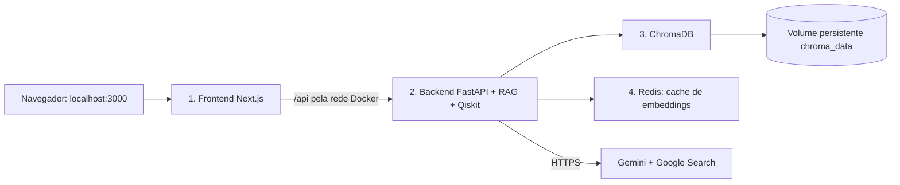

# GrowUp — frontend, API, ChromaDB e cache

Frontend atualizado para a branch develop de julia-deeck/agente-rag-otimizacao-codigo-front, commit cf592cb1df9c3df04e0b3755e544ff2ae1ed9935. CSS, logo, editor OpenQASM, formulário e estrutura das telas vêm dessa versão. Os placeholders de serviço desconectado foram substituídos por integração real. Detalhes: [Migração develop](docs/FRONTEND-DEVELOP.md).

## Iniciar e abrir

Abra PowerShell nesta pasta:

```powershell
docker compose up --build -d --wait
docker compose ps
```

Frontend: http://localhost:3000

Swagger da API: http://localhost:8000/docs

O primeiro build baixa dependências e modelo de embeddings. A API fica pronta após carregar o modelo. A base oficial é alimentada automaticamente em segundo plano na primeira inicialização e atualizada semanalmente. Consulte o andamento:

```powershell
docker compose exec api python -m rag.sincronizar_conhecimento --status
```

A base validada em 13/11/2026 tem 21 fontes oficiais e 2 uploads preservados, totalizando 5.073 trechos. O catálogo inclui circuitos, portas, parâmetros, medições, estados, operadores, primitivas, OpenQASM e transpiração. Snapshots ficam no volume api_data. Os bancos antigos permanecem separados. Consulte [Conhecimento e busca web](docs/CONHECIMENTO-WEB.md) para atualização manual, limites, backup e reconstrução sem internet.

**Busca ampla sob demanda:** a opção **Consultar a internet** usa Google Search via Gemini e mostra fontes identificadas como locais ou web. Resultados web não são gravados no Chroma. Desative a opção para usar somente a base local.

**Dependência atual:** o teste real do Google retornou 429 (cota esgotada). A integração está implementada; respostas com busca web dependem de cota/faturamento e suporte da conta. O frontend mostra a falha, sem simular uma resposta. [Validação desta etapa](docs/VALIDACAO-CONHECIMENTO.md).

## Organização



- Frontend: porta 3000, chamadas pela mesma origem, encaminhadas à API interna.
- API: porta local 8000, contratos anteriores preservados; RAG e Qiskit no mesmo container.
- ChromaDB: coleção única `qiskit_documentacao_multilingue`, sem porta publicada no host. Modelo `sentence-transformers/paraphrase-multilingual-MiniLM-L12-v2`, normalizado, 384 dimensões.
- Redis: somente na rede interna, sem porta publicada. Cache de vetores por hash do modelo/texto, expiração de 1 hora e limite de 128 MB. Reiniciá-lo descarta cache sem perder documentos. Se estiver indisponível durante uma requisição, embeddings são calculados normalmente.
- Volumes existentes `chroma_data`, `model_cache` e `api_data` preservam banco, modelo baixado, avaliações e snapshots documentais. Redis não é fonte de dados persistentes.

## Usar a interface

Preencha o código OpenQASM 2, a pergunta, ou ambos e clique em Analisar.
- Código: validação, transpilação em nível 3, métricas e equivalência reais do Qiskit.
- Pergunta: RAG + Gemini com o top_k selecionado em Configurações.
- Ambos: Qiskit e explicação documental. Se somente a explicação falhar, as métricas são preservadas e a falha é indicada.
- Resultados: fontes com painel de detalhes, circuito otimizado, copiar resultado e voltar ao editor.
- Processamento: voltar aborta a espera do navegador; o backend pode terminar a operação já iniciada.
- Erros: entrada inválida, evidência insuficiente ou serviço indisponível, com retry e entrada preservada.

A escolha Backend de referência não representa hardware IBM. Somente o destino local está disponível, como na branch de origem.
A branch develop não possui tela de documentos. Upload, listagem e busca continuam disponíveis nos endpoints /documents e /search pelo Swagger em http://localhost:8000/docs.

## Credencial e modelo

A credencial está somente no `.env` local, ignorado pelo Git e pelos builds. Nunca use chave em variáveis NEXT_PUBLIC ou no navegador. Em outra instalação, copie `.env.example` para `.env` e preencha GEMINI_API_KEY. Preserve um .env existente.

Modelo configurado: `gemini-3.1-flash-lite`. Na validação de 11/11/2026, Gemini 2.5 Flash recusou novos usuários (404); 3.8 Flash respondeu alta demanda (503); 3.1 Flash Lite respondeu com sucesso. A escolha é explícita, sem troca automática durante requisições.

Após mudar .env: `docker compose up -d --force-recreate api`.
Sem chave: /query retorna 503 LLM_NOT_CONFIGURED. Falha do provedor também aparece como erro; nenhuma resposta é fabricada. Perguntas e trechos enviados à LLM saem para o serviço Google.

## Parar e retomar

```powershell
docker compose down
docker compose up -d --wait
```

Não use `down -v` para preservar os dados. Os bancos antigos de aproximadamente 350 MB continuam fora desta aplicação. Guarde backup integral com os processos antigos parados e preserve os documentos de origem; reconstrua o índice pelo snapshot, sem montar o único exemplar de um banco antigo em outra versão.

## Testes e evidências

Build Next.js/TypeScript e 102 testes backend aprovados nesta etapa (1 teste live omitido). Testes Chromium em scripts/test_frontend.cjs: entrada, Qiskit real, top_k, fontes locais/web, erro QASM, falha/retry, evidência insuficiente, retorno durante processamento e mobile. Nesta etapa, a LLM foi controlada somente no teste de navegador (SKIP_LIVE_LLM=1), devido à cota indisponível. Falhas externas são controladas apenas nos testes. Capturas em artifacts/develop-*.png.

Para backend: docker build --target test -t growup-api-tests . e docker run --rm growup-api-tests.
Para navegador sem consumir cota: defina SKIP_LIVE_LLM=1; as respostas LLM serão controladas somente no teste. Para navegador: instale playwright em ambiente de teste, execute npx playwright install chromium e node scripts/test_frontend.cjs. Sem SKIP_LIVE_LLM=1, este teste chama Gemini real e pode consumir cota.

## Limitações

A API ainda não possui autenticação e as portas ficam restritas ao localhost. Publicação externa exige configuração própria. Fontes recuperadas não garantem correção de todas as afirmações da LLM. Cache não guarda respostas da LLM. Dependências externas, cota e disponibilidade do Gemini podem variar. Há avisos de depreciação de dependências nos testes.

Alterações desta etapa foram feitas somente na pasta local; nenhum push foi realizado.
