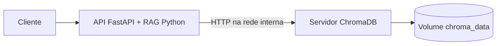

# GrowUp — API integrada ao RAG e ChromaDB

FastAPI e o código Python reutilizável do RAG executam no container `api`. O servidor ChromaDB executa no container `chroma`, acessível somente pela rede interna do Compose. O volume `chroma_data` é a única base vetorial desta aplicação. Não há `PersistentClient`, caminho do computador de origem, cópia de banco local ou migração automática.

`POST /search`, `POST /documents` e `GET /documents` estão integrados. **`POST /query` retorna HTTP 503, código `LLM_NOT_CONFIGURED`: nenhuma LLM foi fornecida ou conectada.** Não há execução nem alteração da lógica de Qiskit.

## Arquitetura e decisões



- Coleção única: `qiskit_documentacao_multilingue`.
- Tenant/database existentes do servidor: `default_tenant` / `default_database`.
- Embeddings: `sentence-transformers/paraphrase-multilingual-MiniLM-L12-v2`, CPU, normalizados; distância `l2`, como o comportamento padrão do RAG original.
- Cliente e servidor ChromaDB fixados em `1.5.9`. A API usa `chromadb-client`, que não inclui o motor local do banco.
- Busca reaproveitada de `Rag/busca_chromadb.py`: consulta chunks candidatos, agrupa por documento/seção e reconstitui a ordem pelo metadado `indice`.
- Chunking e atualização por documento reaproveitados do RAG. Chunks têm até 110 tokens, incluindo o título. A geração dos vetores agora é explícita tanto na busca quanto na indexação.
- O protótipo `chroma_DB` usava `banco_chroma`, coleção `documentacao_qiskit`, embeddings padrão e nenhum metadado de origem. Ele não foi incorporado como segunda base e não é compatível diretamente com a recuperação por seções.
- As diferenças de versões entre os requisitos originais foram conciliadas em um conjunto mínimo. Não foi necessário um terceiro container para o RAG. A resolução para Linux x86_64/Python 3.12 com PyTorch CPU foi verificada; o build Docker ainda precisa ser executado em uma máquina com Docker.

As três pastas de origem foram preservadas. Esta pasta pode ser copiada sozinha para outro diretório ou computador. O snapshot textual em `documentos/base_documental.json` contém as três fontes públicas já fornecidas na pasta RAG; ele não contém embeddings nem arquivos do banco.

## Instalação e inicialização

No Windows, instale e abra o [Docker Desktop com containers Linux](https://docs.docker.com/desktop/setup/install/windows-install/). No Linux, use Docker Engine com o plugin Compose. Não é necessário instalar Python no host para executar os containers.

Abra o terminal **nesta pasta**, onde estão `compose.yaml` e `Dockerfile`:

```powershell
docker --version
docker compose version
docker compose config --quiet
docker compose up --build -d
docker compose logs -f api
```

O primeiro build baixa dependências. Na primeira inicialização, a API baixa o modelo público e aquece os embeddings antes de aceitar chamadas. Isso pode levar vários minutos. O modelo fica no volume `model_cache`, sem entrar no Git ou no contexto de build. Não há chave de IA necessária. `Ctrl+C` encerra apenas o acompanhamento dos logs.

Verifique o estado e abra o Swagger:

```powershell
docker compose ps
Invoke-RestMethod http://localhost:8000/health
```

Swagger: <http://localhost:8000/docs>. O modo esperado é `integrated`. A API escuta apenas em `127.0.0.1` no host. Publicar o repositório não publica um serviço na internet; hospedagem pública ainda exige definir autenticação, HTTPS e operação com a equipe.

O servidor começa com uma coleção vazia. Para reconstruir o índice a partir dos documentos de origem incluídos, execute **após a API ficar pronta**:

```powershell
docker compose exec api python -m rag.indexar_documentos --origem documentos/base_documental.json
```

Esse comando prepara os chunks em memória, gera embeddings e atualiza a mesma coleção do servidor. Reexecutar o mesmo lote reutiliza os IDs; remove somente chunks obsoletos dos documentos daquele lote. Outros documentos, inclusive uploads, são preservados. O total é calculado na execução, não presumido a partir de um banco antigo.

Teste uma busca:

```powershell
$corpo = @{ query = 'Para que serve a transpilação?' } | ConvertTo-Json
Invoke-RestMethod -Method Post -Uri http://localhost:8000/search -ContentType 'application/json' -Body ([Text.Encoding]::UTF8.GetBytes($corpo))
```

Envie e liste um arquivo:

```powershell
curl.exe -X POST http://localhost:8000/documents -F "file=@exemplos/documento.txt"
Invoke-RestMethod http://localhost:8000/documents
```

No Linux/macOS, use `curl` no lugar de `curl.exe`, ou faça as mesmas operações pelo Swagger.

## Rotas e contratos preservados

| Rota | Comportamento integrado |
| --- | --- |
| `GET /health` | API responde com `status=ok`, `mode=integrated`. Após a inicialização, não faz nova sondagem do banco. |
| `POST /search` | Recebe `query`; devolve `chunks`, `citations`, `status`, `request_id`, `mode`. |
| `POST /documents` | Recebe `file` multipart; indexa e retorna 201 com `id`, `filename`, `status=sucesso`, `mode`. |
| `GET /documents` | Consulta o catálogo derivado dos metadados na mesma coleção. |
| `POST /query` | Valida `input` e retorna 503 com o contrato de erro existente e código `LLM_NOT_CONFIGURED`. |
| `POST /evaluate` | Mantém cálculo de notas humanas e registro em JSONL no volume `api_data`. |

O arquivo `contratos.py` foi preservado. O OpenAPI atualizado está em `openapi.json`. Cada fonte continua contendo apenas `document_id`, `chunk_id`, `source`, `content`; os nomes internos do RAG são convertidos pelo adaptador em `servicos.py`.

Uploads aceitos: `.txt`, `.md`, `.py`, `.qasm`, UTF-8, até 256 KiB. Código é tratado como conteúdo textual, nunca executado. Um upload repetido com **mesmo nome e mesmos bytes** reutiliza o ID; o mesmo nome com conteúdo diferente produz outro documento. Para fontes do snapshot sem nome de arquivo, a listagem usa o título no campo `filename`.

Busca vazia retorna 200 com `insufficient_context`. Indisponibilidade do banco retorna 503; resposta incompatível, 502; prazo excedido, 504. Ausência de LLM é uma falha de dependência explícita, não uma resposta falsa de IA nem um resultado `ok`.

## Configuração

Os padrões do Compose funcionam sem `.env`. Para personalizar, copie `.env.example` para `.env` e ajuste os valores. O arquivo `.env` é ignorado pelo Git e pelo Docker build.

| Variável | Padrão / finalidade |
| --- | --- |
| `API_PORT` | `8000`, porta publicada no host |
| `CHROMA_HOST`, `CHROMA_PORT`, `CHROMA_SSL` | `chroma`, `8000`, `0`, definidos para a rede interna pelo Compose |
| `CHROMA_TENANT`, `CHROMA_DATABASE` | `default_tenant`, `default_database` |
| `CHROMA_COLLECTION` | `qiskit_documentacao_multilingue` |
| `EMBEDDING_MODEL` | Modelo multilíngue original; indexação e busca leem o mesmo valor |
| `GROWUP_PERMITIR_DOWNLOAD` | `1` no Compose; use `0` para carregar apenas o cache já populado |
| `CHROMA_STARTUP_TIMEOUT` | `120`, janela de tentativas de conexão após carregar o modelo |
| `CHROMA_HTTP_TIMEOUT_SECONDS` | `30`, timeout do transporte do SDK após conectar; conexão de operações tem limite de 5 s |
| `API_TIMEOUT_SECONDS` | `60`, limite de espera da API por operação |
| `RAG_MAX_DISTANCE` | Vazio: sem corte calibrado de relevância; opcional após avaliação da equipe |
| `AVALIACOES_PATH` | `/app/data/avaliacoes.jsonl` no container |

Não troque o modelo mantendo uma coleção já preenchida. A aplicação verifica o modelo declarado, a normalização, a estratégia de chunks e a métrica da coleção, e recusa uma configuração incompatível. Nenhuma coleção antiga é apagada ou convertida automaticamente. Não altere o nome do projeto Compose para um mesmo ambiente: o nome participa da identificação dos volumes.

## Persistência, preservação e reconstrução

| Volume | Conteúdo |
| --- | --- |
| `growup-integrada_chroma_data` | Única base vetorial, montada em `/data` do servidor |
| `growup-integrada_model_cache` | Modelo público baixado pelo container da API |
| `growup-integrada_api_data` | Avaliações humanas |

```powershell
docker compose down
docker compose up -d
```

Esses comandos preservam os volumes. **Não use `docker compose down -v` se quiser manter os dados**: a opção remove os volumes do projeto.

Os bancos locais das pastas originais, incluindo os arquivos de aproximadamente 350 MB, não foram abertos, copiados, sobrescritos ou migrados. A compatibilidade binária deles com a imagem do servidor não foi validada. Para preservá-los, desligue os processos que os utilizam e mantenha um backup integral do diretório fora deste repositório; preserve também as fontes documentais, configurações e versões originais. Não monte o único exemplar de um banco antigo em uma versão diferente do servidor.

O caminho preparado para o Docker é a reconstrução explícita a partir de `documentos/base_documental.json`, usando o comando de indexação acima. Esse é o único índice ativo da aplicação integrada; o banco local antigo permanece somente como origem preservada/backup. Fontes adicionais que só existam em um banco antigo precisam ser recuperadas pelo responsável e fornecidas como arquivos ou no formato documental original antes de serem indexadas. Não há extração automática do banco antigo.

Para usar outro snapshot, mantenha a lista de documentos com `document_id`, `titulo`, `fonte`, `versao_documentacao`, `coletado_em` e `secoes` contendo `titulo` e `blocos` (`tipo`, `texto`). Copie-o explicitamente para o container e passe seu caminho a `--origem`. Guarde os arquivos de origem: os trechos indexados não substituem um backup fiel dos arquivos enviados.

## Testes

Teste isolado em Python 3.12 pelo Docker, sem baixar embeddings nem criar banco:

```powershell
docker build --target test -t growup-api-tests .
docker run --rm growup-api-tests
```

O estágio `test` é apenas uma imagem de validação; os serviços permanentes continuam sendo dois. Para testar localmente com Python, crie um ambiente novo e execute:

```powershell
python -m venv .venv
.\.venv\Scripts\python.exe -m pip install -r requirements-testes.txt
.\.venv\Scripts\python.exe -m pip check
.\.venv\Scripts\python.exe -m pytest -q
```

Os testes originais da API usam o simulador somente em `tests/demo_original.py`. A aplicação real não seleciona esse simulador. Os novos testes exercitam a ingestão, o adaptador, a reconstrução das seções, idempotência, paginação e erros com dependências controladas. Um teste adicional usa o SDK ChromaDB real com transporte HTTP substituído. Os testes de prompts originais foram preservados.

Após subir os serviços, execute o teste real de ponta a ponta:

```powershell
docker run --rm --network growup-integrada_banco -e GROWUP_TEST_URL=http://api:8000 growup-api-tests python -m pytest -q -p no:cacheprovider -m live
```

Esse teste grava um documento de teste na coleção e o mantém para conferência. Verifica upload, repetição, listagem, busca semântica e a limitação de `/query`. Para verificar persistência, consulte o documento, rode `docker compose down` e `docker compose up -d`, aguarde a API e confirme novamente a listagem e a busca.

Resultados da preparação e verificações pendentes: [docs/VALIDACAO.md](docs/VALIDACAO.md).

## Limitações e pendências da equipe

- Falta definir provedor, modelo, credenciais quando aplicáveis e contrato da chamada de LLM. Os prompts estão preservados como material futuro, mas não são enviados a modelo algum. O contrato português em `docs/PESSOA_4_DOCUMENTACAO.md` é uma proposta original, não substitui os contratos HTTP atuais.
- A recuperação semântica sempre pode encontrar vizinhos próximos em uma coleção não vazia. `status=ok` em `/search` significa que há resultados, não que eles respondem à pergunta. O limiar de rejeição ainda precisa ser calibrado; distância não é confiança percentual.
- A busca reconstitui seções completas. Uma futura integração com LLM precisa controlar orçamento de contexto e avaliar fontes e pertinência.
- Embeddings e acesso síncrono ao banco executam fora do event loop. Um timeout HTTP não interrompe à força uma thread nem desfaz gravações já realizadas. Uma falha parcial de indexação pode exigir reenvio do mesmo arquivo/lote. Não há transação abrangendo todos os documentos.
- O transporte do SDK 1.5.9 é configurado por sua sessão interna para ter timeout após a conexão. O teste do SDK cobre esse ponto; atualizações de versão exigem revalidação. O handshake inicial do SDK não oferece timeout público; não trate o prazo de inicialização como limite absoluto de uma conexão travada.
- Use um worker da API nesta versão. Evite reindexação de lotes simultânea a uploads e consultas; listagem e recuperação não fornecem um snapshot transacional.
- Dependências principais estão fixadas; dependências transitivas e revisão dos arquivos do modelo ainda não têm lock completo. Reproduções futuras devem revalidar os testes.
- Não há autenticação da API, validação de equivalência de circuitos, execução Aer ou avaliação automática por IA.

## Publicação privada no GitHub

O repositório pretendido é `growup-api-chromadb`, branch `main`, visibilidade privada. Não envie as pastas originais, ambientes, bancos ou cache do modelo. `.gitignore` e `.dockerignore` excluem esses artefatos e arquivos usuais de segredos.

Se o GitHub CLI não estiver disponível no Windows:

```powershell
winget install --id GitHub.cli --exact
```

Abra outro terminal e faça a [autenticação pelo navegador](https://cli.github.com/manual/gh_auth_login):

```powershell
gh auth login --hostname github.com --git-protocol https --web
gh auth status
```

Depois, dentro desta pasta, inicialize um repositório independente, revise o que será enviado e faça o commit:

```powershell
git init -b main
git add .
git status --short
git commit -m "Integra API GrowUp ao ChromaDB via Docker"
```

Se o Git solicitar identidade, configure `user.name` e `user.email` com os seus dados antes do commit. Confira o nome remoto na conta autenticada:

```powershell
$contaGrowUp = gh api user --jq .login
gh repo view "$contaGrowUp/growup-api-chromadb" --json url
```

Se o repositório existir, pare e escolha um nome com a equipe; não adicione esse remoto nem faça push sobre ele. Se a consulta falhar por rede/permissão, resolva isso antes de continuar. Somente quando a ausência estiver confirmada, [crie e envie o novo repositório](https://cli.github.com/manual/gh_repo_create):

```powershell
gh repo create growup-api-chromadb --private --source . --remote origin --push
```

Referências técnicas: [Chroma em Docker](https://docs.trychroma.com/guides/deploy/docker) e [cliente HTTP](https://docs.trychroma.com/production/chroma-server/client-server-mode).
