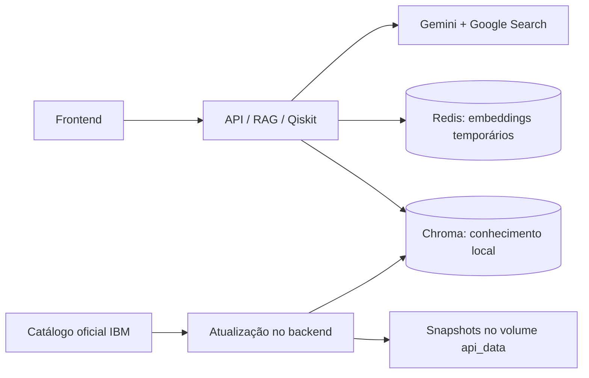

# Base de conhecimento e busca web

## Como funciona

O GrowUp mantém quatro serviços Compose. O backend executa o RAG, o Qiskit e
uma tarefa de atualização documental. Chroma guarda a base permanente;
Redis continua sendo um cache limitado de embeddings. Google Search é acessado
pela ferramenta nativa do Gemini, sem um quinto container nem outra chave.



## Conhecimento permanente

O catálogo em `documentos/fontes_conhecimento.json` começa com 21 páginas:
construção e visualização de circuitos, biblioteca de portas, ordem de bits,
medições, primitivas de simulação, controle clássico, transpiração,
QuantumCircuit, Parameter, estados, operadores e OpenQASM. A referência da API
solicita URLs da versão 2.6, mas a IBM pode redirecioná-las para a versão atual. O snapshot registra a URL efetiva e a solicitada; confira requisitos e versão na página. Guias também podem mudar.
É uma seleção ampla, não uma cópia de toda a documentação nem uma garantia
de responder a qualquer questão avançada.

A primeira inicialização coleta e indexa em segundo plano. Depois, verifica
atualizações a cada sete dias, enquanto a API estiver ligada. Falhas ficam
registradas no status; uma coleta pode ser repetida manualmente.

A coleção e os embeddings existentes são reutilizados. Os três documentos
originais mantêm seus IDs; os uploads são preservados. Um documento sem mudanças
não é reindexado. Cada fonte guarda URL, título, seções, versão e data.
Somente trechos obsoletos do documento atualizado são removidos.

Limites da coleta: 32 páginas no catálogo, 8 MiB por resposta HTTP, 800 mil
caracteres por página, 4 mil chunks por página e 20 mil chunks na coleção para
aceitar novas atualizações automáticas. Esses limites não bloqueiam o endpoint
de upload. Chunks continuam com até 110 tokens. Os limites controlam quantidade,
não garantem um tamanho exato em disco. Exclusões podem não reduzir imediatamente
os arquivos físicos do Chroma.

O coletor aceita apenas HTTPS no domínio oficial IBM, valida redirecionamentos,
consulta robots.txt e espaça requisições. Não coleta URLs arbitrárias da pergunta.
O snapshot anterior e o atual são mantidos; o histórico não cresce indefinidamente.
Remover uma fonte do catálogo interrompe a atualização, mas não apaga seus dados.

## Operação

Na pasta do projeto:

```powershell
docker compose up --build -d --wait
docker compose exec api python -m rag.sincronizar_conhecimento --status
docker compose exec api python -m rag.sincronizar_conhecimento
```

O segundo comando mostra o progresso, páginas e falhas. O terceiro atualiza
imediatamente. Uma trava impede duas atualizações simultâneas. Apenas um worker
Uvicorn é usado no Compose atual.

Configurações em .env, sem publicar segredos:

```dotenv
WEB_SEARCH_ENABLED=1
GEMINI_WEB_MODEL=
KNOWLEDGE_AUTO_SYNC=1
KNOWLEDGE_SYNC_INTERVAL_SECONDS=604800
```

Modelo web vazio usa GEMINI_MODEL. KNOWLEDGE_AUTO_SYNC=0 desativa o agendamento.
O menor intervalo é uma hora. Após mudanças, recrie a API:
`docker compose up -d --force-recreate api`.

## Busca ampla durante a pergunta

No frontend, a opção **Consultar a internet** fica nas configurações.
Desativá-la usa apenas o contexto do Chroma. No endpoint:

```json
{"input":"Como construir um circuito parametrizado no Qiskit?","top_k":5,"web_search":true}
```

`web_search` omitido usa WEB_SEARCH_ENABLED. A LLM decide quando executar
buscas; habilitar a ferramenta não garante uma chamada ao Google em cada pergunta.
A resposta inclui `web_status`: disabled, used (fontes com apoio retornadas) ou
not_used. Fontes locais usam [Fonte N]; fontes web usam [Web N].
Fontes web têm origin=web, URL, título e data da consulta. O campo content dessas
fontes contém afirmações da resposta vinculadas pelo provedor, **não a transcrição
literal da página**. O frontend permite abrir as fontes e mostra as sugestões
Google em iframe isolado, sem execução de scripts.

Nenhum resultado web é indexado automaticamente no Chroma. Também não guardamos
respostas Gemini/Google no Redis. Assim, perguntas não aumentam a base permanente.
Redis mantém somente embeddings, com expiração e limite de 128 MB.
O conteúdo recuperado é tratado como evidência, nunca como instruções a executar.
Essa proteção reduz riscos de instruções maliciosas, mas não torna respostas
da LLM infalíveis.

Google recebe a pergunta e o contexto enviado ao Gemini. A ferramenta de busca
pode gerar consultas externas. Evite fornecer segredos no conteúdo de perguntas.
Grounding pode ter cobrança/cota própria. Uma chave válida não garante cota
ou acesso à ferramenta no modelo selecionado.

Falha de busca: HTTP 503 WEB_SEARCH_UNAVAILABLE, sem fingir que houve busca.
Sem chave: HTTP 503 LLM_NOT_CONFIGURED. Sem evidência local e sem fontes web:
insufficient_context. Nenhuma resposta real é simulada.
POST /search continua sendo a busca local, com seu contrato anterior.

Referências do provedor:
- https://ai.google.dev/gemini-api/docs/generate-content/google-search
- https://ai.google.dev/gemini-api/docs/pricing
- https://ai.google.dev/gemini-api/terms

## Preservação e reconstrução

O volume chroma_data mantém o índice; api_data mantém
/app/data/conhecimento, com snapshots e status. Não execute down -v.
Um backup lógico anterior à ampliação foi salvo em
artifacts/backup-preconhecimento.json (ignorado pelo Git) e no volume api_data.
Ele inclui os 156 registros originais desta instância, metadados e embeddings.

Para exportar os snapshots atuais sem segredos:

```powershell
docker compose cp api:/app/data/conhecimento ./artifacts/conhecimento
```

Para reconstruir os documentos do catálogo a partir dos snapshots do volume,
sem acessar a internet:

```powershell
docker compose exec api python -m rag.sincronizar_conhecimento --reindex
```

Esse comando atualiza somente IDs do catálogo. Preserve também os arquivos
originais enviados por upload, que não são incorporados nesses snapshots.
Para restaurar em outra instalação, copie a pasta conhecimento para
/app/data/conhecimento no volume api_data, com permissão para o usuário growup
(uid 10001), e execute --reindex. O snapshot inicial de três documentos continua
em documentos/base_documental.json.

Uma falha de coleta mantém os registros anteriores. Escritas Chroma em lotes
não são transações de documento inteiro: uma interrupção durante a gravação
pode deixar parte dos trechos atualizada. O snapshot completo permite repetir
--reindex; arquivos com indexed=false não são considerados concluídos.

## Validação

Testes cobrem o contrato anterior, extração de HTML, redirecionamento para
endereço não permitido, metadados de grounding, ausência de fontes, falhas do
provedor, não persistência da busca web, atualização idempotente e reconstrução
sem internet. O transporte Google é controlado nos testes unitários.

A tentativa real com a chave local retornou 429 RESOURCE_EXHAUSTED.
Até haver cota disponível, a busca web real e a geração de respostas não podem
ser certificadas como funcionais nesta conta. Não substituímos a resposta por
dados fabricados. Resultados finais da coleta e execução estão em
docs/VALIDACAO-CONHECIMENTO.md.
